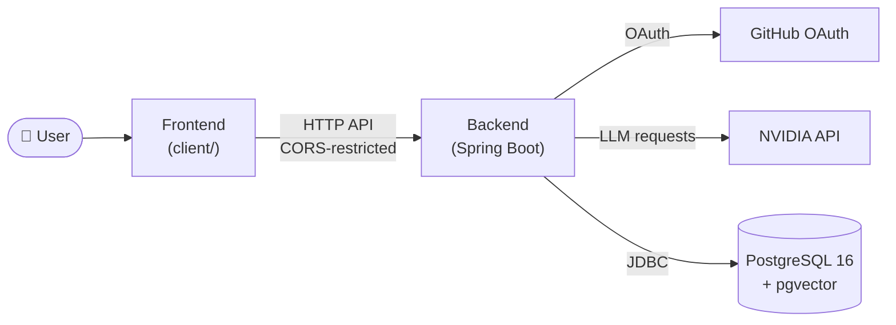

<div align="center">

# DevPilot

**An AI-powered development assistant that helps developers move from idea to implementation.**

Plan, build, and improve software projects with a more focused everyday workflow.

[](https://devpilot-fe.onrender.com/)


[Live Demo](https://devpilot-fe.onrender.com/) · [Repository](https://github.com/DhawalThombare37/Dev-Pilot) · [Report an Issue](https://github.com/DhawalThombare37/Dev-Pilot/issues)

</div>

---

## Table of Contents

- [Live Demo](#-live-demo)
- [Overview](#-overview)
- [Key Features](#-key-features)
- [System Architecture](#-system-architecture)
- [Technology Stack](#-technology-stack)
- [Project Structure](#-project-structure)
- [Installation and Setup](#-installation-and-setup)
- [Environment Variables](#-environment-variables)
- [Screenshots](#-screenshots)
- [Contributing](#-contributing)
- [License](#-license)
- [Author](#-author)

---

## 🌐 Live Demo

DevPilot's frontend is deployed on Render:

**👉 [https://devpilot-fe.onrender.com/](https://devpilot-fe.onrender.com/)**

| Component | Status |
|-----------|--------|
| Frontend | Deployed on [Render](https://render.com) |

> [!NOTE]
> Sign-in uses GitHub OAuth, so you will need a GitHub account to log in.

<!-- TODO(verify): confirm the backend hosting provider/URL and whether Render's free tier causes cold starts. If it does, add a note here that the first load can be slow. -->

---

## 📖 Overview

DevPilot is an AI-powered development assistant designed to help developers move from idea to implementation. It supports planning, building, and improving software projects, making everyday development workflows more focused and productive.

<!-- TODO(verify): expand with the specific problem DevPilot solves and what makes the approach useful, once the implemented features are confirmed from source. -->

---

## ✨ Key Features

The following capabilities are confirmed by the project's configuration:

| Capability | Details |
|------------|---------|
| 🤖 **LLM integration** | Backend calls an LLM through the NVIDIA API (`NVIDIA_API_KEY`) |
| 🔐 **GitHub OAuth** | Sign-in via GitHub, using a configured OAuth client ID and secret |
| 🛡️ **Encrypted token storage** | GitHub tokens are encrypted at rest using a configurable password and salt |
| 🧠 **Vector-ready database** | PostgreSQL 16 runs with the `pgvector` extension via Docker Compose |
| 🐳 **One-command database** | Local Postgres starts with `docker compose up -d postgres` |

<!-- TODO(verify): add each AI feature (coding assistance, repository understanding, RAG, PR/diff analysis, repository health checks, log analysis) ONLY after confirming it in backend-devpilot/ and client/. Label each as Working / Partial / Planned. -->

---

## 🏗️ System Architecture

High-level view of the components confirmed by the project configuration:



<!-- TODO(verify): add the AI/RAG workflow diagram (ingestion, chunking, embeddings, retrieval, response generation) only after confirming each stage exists in the backend source. -->

---

## 🧰 Technology Stack

| Category | Technology |
|----------|------------|
| **Backend** | Spring Boot |
| **Build tool** | Maven |
| **Database** | PostgreSQL 16 with `pgvector` (`pgvector/pgvector:pg16` image) |
| **AI / LLM** | NVIDIA API |
| **Authentication** | GitHub OAuth |
| **DevOps** | Docker Compose, Render (frontend hosting) |

<!-- TODO(verify): add frontend framework, Java version, embedding model, and LLM model name from client/package.json and backend-devpilot/pom.xml / application properties. -->

---

## 📁 Project Structure

```text
Dev-Pilot/
├── backend-devpilot/        # Spring Boot backend
├── client/                  # Frontend application
├── docker/
│   └── postgres/            # Postgres init scripts (extensions)
├── docker-compose.yml       # Local Postgres + pgvector
├── .env.example             # Environment variable template
├── SECRETS.md               # Secrets and environment setup guide
└── LICENSE                  # MIT License
```

<!-- TODO(verify): add a one-line description for key subfolders and files inside backend-devpilot/ and client/. -->

---

## 🚀 Installation and Setup

### Prerequisites

- [Git](https://git-scm.com/)
- [Docker](https://www.docker.com/) with Docker Compose
- JDK and Maven (for the backend)
- Node.js and npm (for the frontend)
- A [NVIDIA API key](https://build.nvidia.com/)
- A [GitHub OAuth App](https://github.com/settings/developers) (client ID and secret)

<!-- TODO(verify): state the required JDK and Node.js versions. -->

### 1. Clone the repository

```bash
git clone https://github.com/DhawalThombare37/Dev-Pilot.git
cd Dev-Pilot
```

### 2. Configure environment variables

```bash
cp .env.example .env
```

Open `.env` and replace every placeholder with your own values. See [Environment Variables](#-environment-variables).

> [!IMPORTANT]
> Docker Compose reads `.env` automatically, but **Spring Boot does not**. Export the same variables in your shell or set them in your IDE run configuration before starting the backend.

### 3. Start the database

```bash
docker compose up -d postgres
```

PostgreSQL is exposed on port `5433` by default.

### 4. Start the backend

```bash
cd backend-devpilot
mvn spring-boot:run
```

<!-- TODO(verify): confirm the exact command (mvn spring-boot:run vs ./mvnw spring-boot:run) and the backend port. -->

### 5. Start the frontend

```bash
cd client
cp .env.example .env.local   # only if you need to change the API URL
npm install
npm run dev
```

<!-- TODO(verify): confirm the package manager and dev script in client/package.json. -->

### 6. Open the app

The backend's `FRONTEND_URL` and `CORS_ALLOWED_ORIGINS` default to `http://localhost:3000`, so open:

**http://localhost:3000**

---

## 🔑 Environment Variables

Copy [`.env.example`](.env.example) to `.env`. Never commit real credentials. See [`SECRETS.md`](SECRETS.md) for the full secrets guidance.

| Variable | Purpose | Required |
|----------|---------|----------|
| `DB_PASSWORD` | PostgreSQL password | ✅ Required |
| `NVIDIA_API_KEY` | API key for the NVIDIA-hosted LLM | ✅ Required |
| `GITHUB_CLIENT_ID` | GitHub OAuth app client ID | ✅ Required |
| `GITHUB_CLIENT_SECRET` | GitHub OAuth app client secret | ✅ Required |
| `TOKEN_ENCRYPTOR_PASSWORD` | Secret used to encrypt stored tokens | ✅ Required |
| `TOKEN_ENCRYPTOR_SALT` | Salt used for token encryption | ✅ Required |
| `DB_NAME` | Database name (default `devpilot`) | Optional |
| `DB_USERNAME` | Database user (default `postgres`) | Optional |
| `DB_PORT` | Host port for Postgres (default `5433`) | Optional |
| `DB_URL` | JDBC connection URL for the backend | Set in `.env.example` |
| `FRONTEND_URL` | Frontend origin (`http://localhost:3000`) | Set in `.env.example` |
| `CORS_ALLOWED_ORIGINS` | Origins allowed to call the API | Set in `.env.example` |

> [!WARNING]
> Use a unique, high-entropy `TOKEN_ENCRYPTOR_PASSWORD` and `TOKEN_ENCRYPTOR_SALT`. Changing either later can make previously encrypted tokens unreadable.

---

## 🖼️ Screenshots

> Screenshots will be added here.

| Dashboard | Feature view |
|:---------:|:------------:|
| _Coming soon_ | _Coming soon_ |

<!-- TODO(user): add real screenshots to a docs/screenshots/ folder and reference them here. Do not link images that do not exist. -->

---

## 🤝 Contributing

Contributions are welcome.

1. Fork the repository.
2. Create a feature branch: `git checkout -b feature/your-feature`
3. Commit your changes with a clear message.
4. Push the branch and open a Pull Request.

Never commit `.env` files or credentials. Review [`SECRETS.md`](SECRETS.md) before submitting.

---

## 📄 License

Distributed under the **MIT License**. Copyright © 2026 Dhawal Thombare. See [`LICENSE`](LICENSE) for details.

---

## 👤 Author

**Dhawal Thombare**

[](https://github.com/DhawalThombare37)

<div align="center">

If you find DevPilot useful, consider giving the repository a ⭐

</div>
